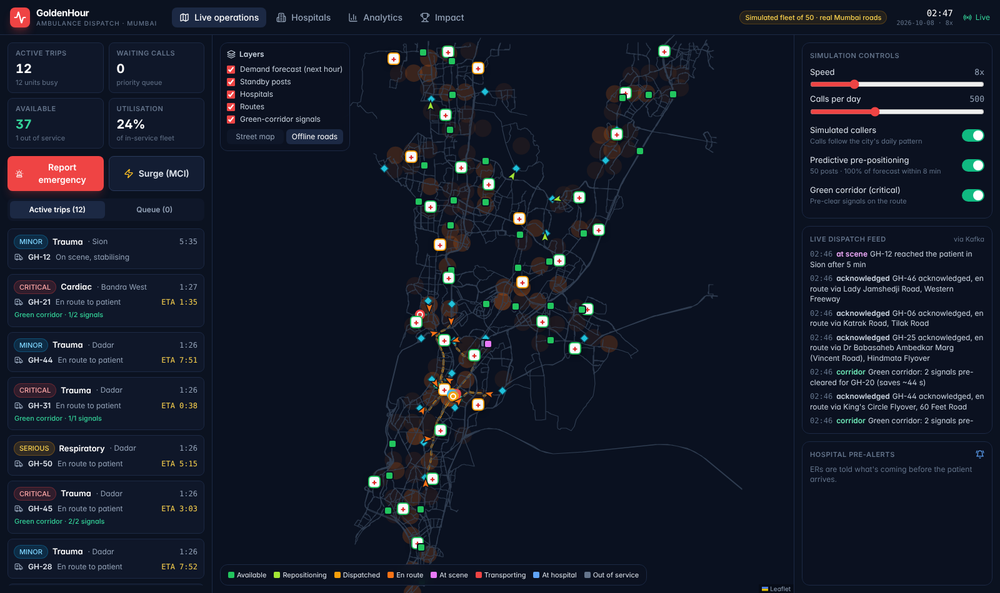
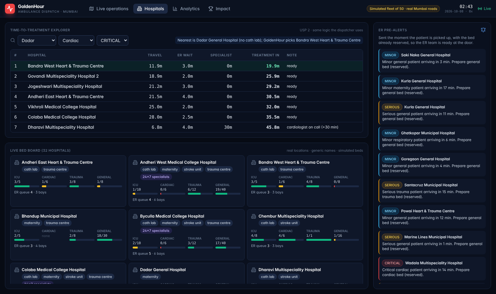
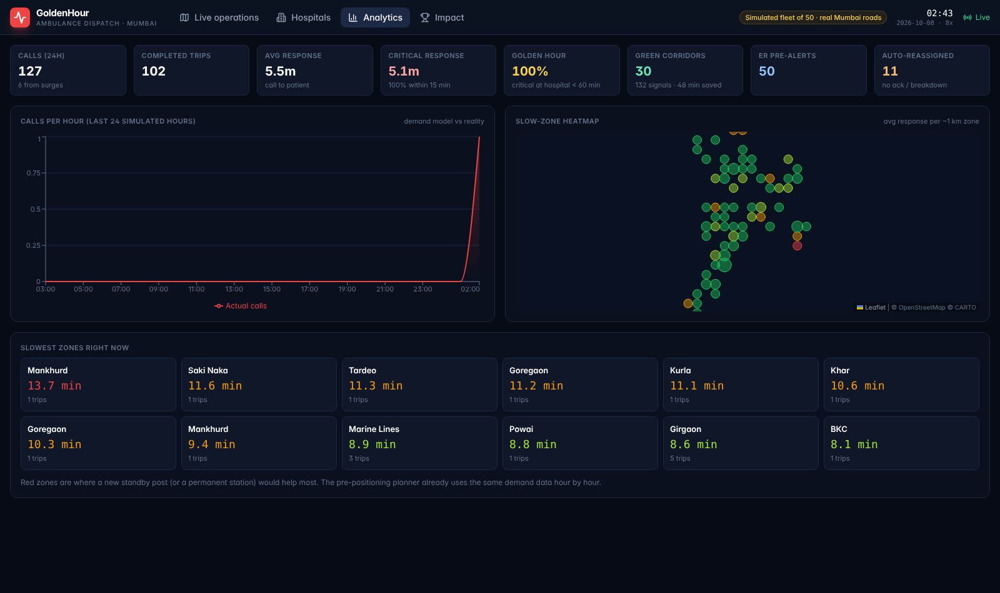
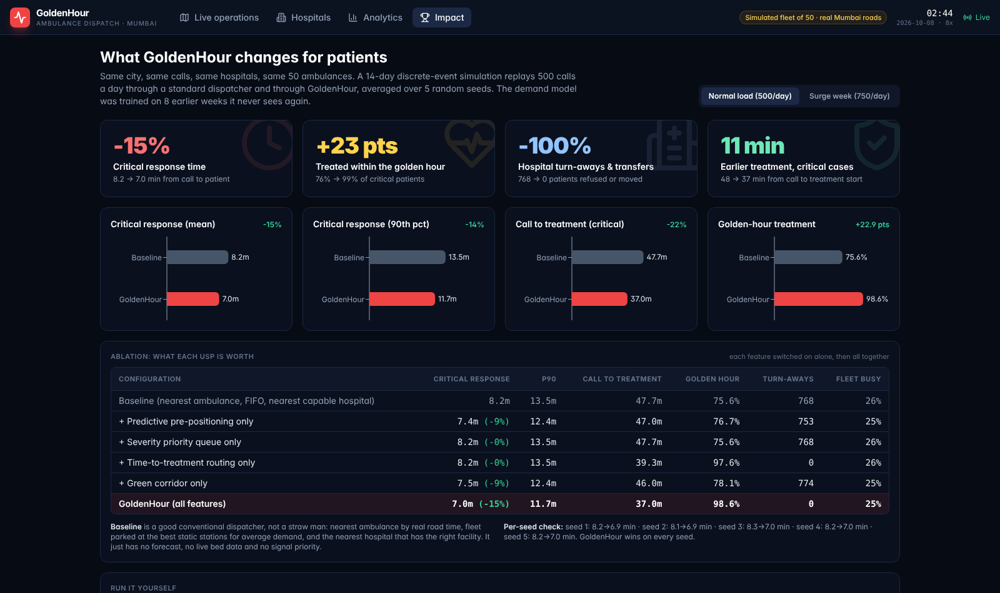
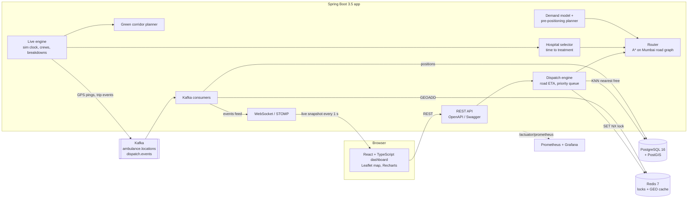

# GoldenHour: real-time ambulance dispatch for Mumbai

A heart-attack or road-accident patient has roughly one "golden hour" in which treatment saves lives.
In Indian cities that hour is lost in three places: the ambulance starts far away, it waits at red
signals, and it often drives to the *nearest* hospital, which turns out to have no cath lab, no free
ICU bed or no specialist on duty, so the patient is moved again.

**GoldenHour** is a dispatch system that attacks all three. It runs a simulated fleet of 50 ambulances on
the **real Mumbai road network** (64,075 junctions, 80,706 road segments from OpenStreetMap) with 32 real
hospital locations, and shows everything live on a map.

> The fleet, calls and hospital bed counts are simulated. Roads, hospital locations and all the
> engineering are real. No paid APIs or keys: everything runs offline on your laptop.



## Results

A discrete-event simulation replays the **same calls** through a good conventional dispatcher and through
GoldenHour: 14 days, 500 calls a day, 50 ambulances, averaged over 5 random seeds. The demand model is
trained on 8 earlier weeks it never sees again. Full output: [docs/simulation-results.txt](docs/simulation-results.txt).

| Metric (critical patients) | Baseline | GoldenHour | Change |
|---|---|---|---|
| Mean response time (call to ambulance at patient) | 8.2 min | **7.0 min** | **-15%** |
| 90th percentile response | 13.5 min | 11.7 min | -14% |
| Call to treatment start | 47.7 min | **37.0 min** | -22% |
| Treated within the golden hour | 75.6% | **98.6%** | **+22.9 pts** |
| Patients turned away / transferred (all severities) | 768 | **0** | -100% |

**Surge week (+50% calls, 750 a day):** critical response 14.7 → 11.3 min (-23.5%), golden-hour treatment
59.5% → 89.2% (+29.7 pts). GoldenHour wins on every seed in both scenarios.

What each idea is worth on its own (normal load):

| Feature switched on alone | Critical response | Golden hour |
|---|---|---|
| Predictive pre-positioning | 8.2 → 7.4 min | 75.6 → 76.7% |
| Severity priority queue | no change (no queue at normal load; matters in surge: 14.7 → 13.5 min) | |
| Time-to-treatment hospital routing | no change | 75.6 → **97.6%** |
| Green corridor | 8.2 → 7.5 min | 75.6 → 78.1% |
| **All together** | **7.0 min** | **98.6%** |

The baseline is deliberately not a straw man: it picks the nearest ambulance by *real road time*, parks
the fleet at the best 25 static stations for average demand, and sends patients to the nearest hospital
that has the right facility. It just has no forecast, no live bed data and no signal priority.

**Load test (k6, Docker on a laptop-class VM):** 1,630 emergency calls ramping to 20 per second plus 20
dashboards polling live state, 3,630 requests in 100 s: **p95 14 ms** to create and dispatch an incident,
**0 errors**. Integration tests fire 20 simultaneous calls at the same street and check that no ambulance
is ever booked twice. ([docs/load-test-results.txt](docs/load-test-results.txt))

## Features

**Core**
- Emergency intake with location (click on the map), severity and patient type.
- Nearest free ambulance by **road** ETA, never double-booked (Redis lock + database compare-and-set).
- Hospital matching by free ICU / cardiac / trauma / general beds; the bed is reserved when chosen.
- Trip lifecycle as a state machine: assigned → en route → at scene → picked up → at hospital → closed.
- Live map: ambulances drive along real roads, updates pushed over WebSockets every second.

**Standout**
- Severity **priority queue with aging**: critical calls jump ahead, minor calls are never starved.
- **Auto-reassignment** if the crew doesn't acknowledge within 30 s or the ambulance breaks down
  (try the "Simulate breakdown" button).
- **Live ETA** from road distance and time-of-day traffic (night / off-peak / peak).
- **Hospital pre-alert**: the ER sees "critical cardiac, arriving in 7 min" before the patient arrives.
- **Surge mode** (mass-casualty incident): one click creates 2-20 patients, dispatches several
  ambulances and spreads patients across hospitals.

**Three USPs**
1. **Predictive pre-positioning.** A demand model learns where and when emergencies happen (per ~1 km
   cell, per hour of the week) and every 10 minutes moves idle ambulances to the standby posts that
   cover the next hour's expected calls (greedy p-median over road travel times).
2. **Time-to-treatment hospital routing.** Picks the hospital where treatment *starts* soonest:
   travel + ER queue + specialist on duty or on call + a free bed of the right type. The dashboard explains
   each choice, for example "treatment in ~14 min; skipped nearer X (no cath lab)".
3. **Automatic green corridor.** For critical trips every signalised junction on the route gets a
   pre-emption window from 20 s before to 15 s after the ambulance's ETA; the map shows signals turning green.

**Analytics:** response time by zone with a slow-zone heatmap, calls vs forecast per hour, fleet
utilisation, corridor minutes saved, and an Impact page with the simulation results and a "run it yourself" button.

| Hospitals | Analytics | Impact |
|---|---|---|
|  |  |  |

## Architecture



**One dispatch, step by step**
1. A call arrives (`POST /api/incidents`), is snapped to the nearest road and saved.
2. PostGIS returns the 8 nearest free ambulances in a straight line (KNN `<->` on a partial GiST index).
3. One Dijkstra search from the patient computes the real road time to all 8; they're tried fastest first.
4. For each candidate: take a Redis lock (`SET NX PX` with a random token), then in one transaction
   claim the ambulance (`UPDATE ... WHERE status IN ('AVAILABLE','REPOSITIONING')`) and the incident
   (`WHERE status='QUEUED'`). If either update hits 0 rows someone else got there first: roll back, try the next.
   If every candidate was grabbed by parallel calls, search again (the new state is visible).
5. The trip is created and handed to the live engine. If the crew doesn't acknowledge within 30 s the
   trip is cancelled and the call goes back to the priority queue.
6. At pickup the hospital selector ranks all 32 hospitals by time to treatment, reserves a bed (optimistic
   locking with retry) and sends the ER a pre-alert. Critical trips get a green corridor.
7. Every state change becomes a Kafka event; consumers update the database, the Redis GEO cache, metrics
   and the dashboard's live feed.

## Tech stack

| Layer | Choice |
|---|---|
| Backend | Java 17, Spring Boot 3.5, Spring Data JPA / Hibernate, Bean Validation, springdoc OpenAPI |
| Database | PostgreSQL 16 + PostGIS (generated geography columns, GiST KNN), Flyway migrations |
| Concurrency | Redis distributed lock (token + Lua compare-and-delete), compare-and-set SQL updates, JPA `@Version` |
| Streaming | Apache Kafka 3.9 (KRaft, no ZooKeeper), 3 partitions keyed by ambulance id, 3 consumer groups |
| Real time | Spring WebSocket + STOMP |
| Routing | Own road graph (compressed sparse row arrays), A*, one-to-many Dijkstra, precomputed travel-time tables |
| Forecasting | Poisson rate per grid cell × hour of week with shrinkage; greedy p-median placement |
| Frontend | React 18, TypeScript, Vite, Tailwind CSS, Leaflet, Recharts, STOMP.js |
| Testing | JUnit 5, AssertJ, Testcontainers (PostGIS, Redis, Kafka), concurrency test, k6 load test |
| Ops | Docker multi-stage build, Docker Compose, Actuator, Micrometer + Prometheus, Grafana dashboard, GitHub Actions CI |

## Run it (Windows, step by step)

You need **Docker Desktop** only. Java, Node and Maven are not needed; Docker builds everything.

1. Open **Docker Desktop** and wait until the bottom-left says **Engine running**.
2. Get the code: unzip `ambulance-dispatch.zip`, or clone it with
   `git clone https://github.com/anannya-sys/ambulance-dispatch-system.git`. You get a folder with
   `docker-compose.yml` directly inside it (for example `D:\java_projects\ambulance-dispatch-system`).
3. Open that folder in File Explorer, click the address bar, type `cmd` and press **Enter**.
   A black Command Prompt window opens in the right folder.
4. Type this and press **Enter**:
   ```
   docker compose up --build
   ```
   The first run downloads images and builds the app, which takes about 5-10 minutes. It's ready when you see
   `Started GoldenHourApplication`.
5. Open **http://localhost:8080** in Chrome or Edge. Ambulances start moving and calls start arriving.
6. To stop: press **Ctrl + C** in the Command Prompt window, then run `docker compose down`.
   To also wipe the database, run `docker compose down -v`.

**Things to try on the dashboard**
- Click **Report emergency**, click a spot on the map, pick *Critical* + *Cardiac*, submit. Watch the
  ambulance get assigned, the route turn red, signals on the route go green, and the hospital choice explained.
- Click **Surge (MCI)** for a 10-patient building collapse.
- Click a moving ambulance and press **Simulate breakdown** to watch reassignment.
- Use the speed slider (0.5× to 60×) and the toggles to switch pre-positioning or the green corridor off.
- **Impact** tab: the simulation results, plus a button to run a quick simulation yourself.

**Other links:** Swagger UI at http://localhost:8080/swagger-ui.html, Prometheus metrics at
http://localhost:8080/actuator/prometheus.

**Optional extras**
```
docker compose --profile monitoring up -d      # Grafana at http://localhost:3000 (dashboard "GoldenHour dispatch")
docker compose --profile loadtest run --rm k6  # k6 load test against the running app
```

**If something goes wrong**
- *"port is already allocated"*: another program uses 8080, 5432, 6379 or 9092. Close it, or change the
  left-hand port number in `docker-compose.yml` (for example `"8081:8080"`).
- *The map shows dark road lines instead of a street map*: you're offline, so the app draws its own road
  map. Everything else works.
- *Docker runs out of memory*: Docker Desktop → Settings → Resources, give it at least 4 GB.

### Run without Docker for development
Start only the infrastructure with `docker compose up postgres redis kafka`, then
`cd backend && mvn spring-boot:run` and, in another window, `cd frontend && npm install && npm run dev`
(dev server on http://localhost:5173 proxies to the backend).

### Tests
```
cd backend
mvn test      # 24 unit tests (routing, hospital choice, demand model, corridor, short simulation)
mvn verify    # + 7 Testcontainers integration tests (needs Docker running)
```

### Re-run the evaluation
```
cd backend
mvn -q package -DskipTests
java -cp target/classes:$(mvn -q dependency:build-classpath -Dmdep.outputFile=/dev/stdout) \
     com.goldenhour.dispatch.evaluation.EvaluationMain 5 14 ../docs
```
Arguments: seeds, days, output folder. Takes about 4 minutes on 4 cores. The Impact tab can also run a
quick 1-seed version from the browser.

## API examples

```bash
# Report a critical cardiac emergency in Bandra West
curl -X POST localhost:8080/api/incidents -H "Content-Type: application/json" \
  -d '{"lat":19.0596,"lon":72.8295,"severity":"CRITICAL","patientType":"CARDIAC","description":"Chest pain, 58 y/o"}'
# -> 201 {"incident":{"id":128,"status":"ASSIGNED","area":"Bandra West",...},
#         "assignment":{"tripId":139,"callSign":"GH-21","etaMinutes":4.2}, ...}

# Mass-casualty incident: 10 patients at Dadar
curl -X POST localhost:8080/api/incidents/surge -H "Content-Type: application/json" \
  -d '{"lat":19.0178,"lon":72.8478,"casualties":10,"description":"Building collapse"}'

# Incident timeline (every state change with its time)
curl localhost:8080/api/incidents/128

# Calls waiting for an ambulance, in priority order
curl localhost:8080/api/incidents/queue

# Which hospital would treat a stroke patient soonest from Andheri? (ranked, with reasons)
curl "localhost:8080/api/hospitals/recommendation?lat=19.1197&lon=72.8468&severity=CRITICAL&patientType=STROKE"

# GPS ping from an ambulance device (goes through Kafka)
curl -X POST localhost:8080/api/ambulances/7/location -H "Content-Type: application/json" \
  -d '{"lat":19.033,"lon":72.855,"heading":90,"speedKmph":35}'
# -> 202 {"status":"accepted"}

# Ambulances within 3 km (Redis GEO)
curl "localhost:8080/api/ambulances/nearby?lat=19.033&lon=72.855&radiusKm=3"

# Break down an ambulance (its call is reassigned)
curl -X POST localhost:8080/api/ambulances/21/breakdown

# Live KPIs, slow zones, next-hour demand forecast, simulation results
curl localhost:8080/api/analytics/summary
curl localhost:8080/api/analytics/zones
curl localhost:8080/api/sim/forecast
curl localhost:8080/api/evaluation
```

Errors use RFC 7807 problem details, for example a location in the sea returns
`400 {"detail":"Location is outside the Mumbai service area"}`.

## Design decisions

- **Own router instead of Google Maps or OSRM.** Offline, free, and it lets the green corridor change
  travel time at signals. The road graph is built once from OpenStreetMap (`tools/`) and shipped as a 2.3 MB
  binary; it loads in about 2 seconds. Travel times from all hospitals and standby posts to every junction
  are precomputed per traffic band, so ranking 32 hospitals is 32 array lookups.
- **Two layers against double booking.** The Redis lock stops two dispatchers from even *trying* the same
  ambulance at once (cheap, fast). The SQL compare-and-set is the real guarantee: if Redis fails or a lock
  expires, the database still lets exactly one claim win.
- **PostGIS straight-line KNN, then road times.** The index cuts 50 ambulances to 8 in microseconds; one
  Dijkstra from the patient then gives exact road times to those 8.
- **Kafka for telemetry and events.** 50 ambulances pinging every few seconds is the high-volume path. Keying
  by ambulance id keeps each ambulance's pings in order. Three consumer groups (tracking, dashboard relay,
  metrics) read the same stream independently.
- **Time to treatment, not distance.** The ablation shows hospital choice alone takes golden-hour treatment
  from 75.6% to 97.6%: the biggest single win, and it costs nothing but data hospitals already have.
- **Simulation shares code with the live system.** `HospitalSelector`, `GreenCorridorPlanner`,
  `PrePositioningPlanner` and `DispatchPriority` are plain classes used by both, so the measured numbers
  describe the real decision logic, not a copy of it.
- **State machine for trips.** Every transition is checked; an illegal jump throws instead of corrupting data.

## Assumptions and limits

- Calls are synthetic: 34 hotspots (stations, offices, markets, nightlife, elderly areas) with daily
  profiles plus 40% background calls, about 500 a day.
- Hospital beds, ER queues and specialist rosters are simulated; hospital names are generic, locations real.
- Traffic is a time-of-day speed factor per road class, not live traffic. Roads are treated as two-way.
- Ambulance crews, acknowledgement delays (4-18 s, 4% never acknowledge) and breakdowns (1%) are simulated.
- Signal pre-emption is modelled as 25 s average wait per signal vs 3 s with a corridor.

## Future improvements

- Transactional outbox so a database commit and its Kafka event can never diverge.
- One-way streets and turn restrictions in the road graph; live traffic feed.
- Real GPS devices and a crew mobile app for acknowledgement.
- Integration with hospital bed systems (for example ABDM / state bed dashboards).
- Multiple dispatcher instances behind a load balancer (the locking design already allows it).

## Project layout

```
ambulance-dispatch-system/
├── docker-compose.yml        postgis, redis, kafka, app (+ optional prometheus, grafana, k6)
├── Dockerfile                builds the React dashboard and the Spring Boot jar into one image
├── backend/src/main/java/com/goldenhour/dispatch/
│   ├── routing/   road graph, A*, Dijkstra, traffic model, travel-time tables
│   ├── dispatch/  dispatch engine (locks, compare-and-set, priority queue)
│   ├── incident/  intake, severity, priority with aging
│   ├── hospital/  beds, time-to-treatment selector, pre-alerts, census simulator
│   ├── corridor/  green corridor planner
│   ├── forecast/  synthetic call pattern, demand model, pre-positioning
│   ├── fleet/  trip/  live/  messaging/  realtime/  analytics/  api/  config/
│   └── evaluation/  offline baseline-vs-GoldenHour simulation
├── backend/src/main/resources/  application.yml, Flyway SQL, road graph, hospital sites
├── frontend/src/             React dashboard (Live operations, Hospitals, Analytics, Impact)
├── loadtest/  monitoring/  tools/  .github/workflows/
└── docs/                     plan, simulation and load-test results, screenshots
```

Map data © OpenStreetMap contributors (ODbL), via Overture Maps. Map tiles © CARTO when online.
